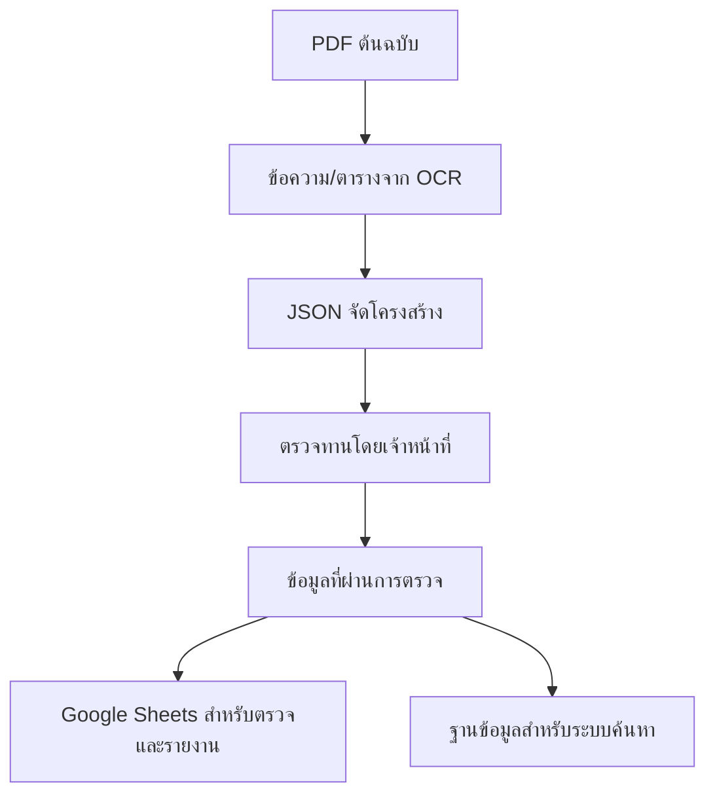

# TEF Results Archive — README

เอกสารนี้สรุปแนวคิดสำหรับจัดเก็บผลการแข่งขันกีฬาขี่ม้าของสมาคมกีฬาขี่ม้าแห่งประเทศไทย (TEF) จากไฟล์ PDF/OCR เพื่อนำไปตรวจทาน ค้นหาตามนักกีฬา และพัฒนาเป็นระบบในอนาคต

> สถานะปัจจุบัน: อยู่ระหว่างศึกษาและจัดโครงสร้างข้อมูล ยังไม่ได้สั่งให้แก้ Google Sheet สร้างระบบ หรือถอดเอกสารทั้งหมดใหม่ ตัวอย่างคะแนนในเอกสารนี้เป็นข้อมูลสมมติสำหรับอธิบายโครงสร้าง JSON เท่านั้น

## 1. เป้าหมาย

- เก็บผลการแข่งขันย้อนหลังจาก PDF ให้ค้นหาและตรวจสอบย้อนกลับได้
- รองรับผลการแข่งขันที่มีโครงสร้างต่างกัน ได้แก่ Jumping, Dressage, Eventing และ Endurance
- ค้นหาด้วย TEF ID หรือ FEI ID ได้เมื่อมีการเชื่อมกับทะเบียนนักกีฬา
- เก็บชื่อที่พิมพ์ในเอกสารเดิมไว้ เพื่อไม่ให้การจับคู่ชื่อผิดทำลายหลักฐานต้นทาง
- แยกข้อมูล OCR ที่ยังไม่ตรวจออกจากผลที่เจ้าหน้าที่ตรวจหรือรับรองแล้ว
- รองรับการแก้ไขโดยเก็บประวัติ แหล่งที่มา ไฟล์ และเลขหน้า

## 2. แหล่งข้อมูลปัจจุบัน

- ไฟล์ต้นทาง: `/Users/mac_phalot/Downloads/ผลการแข่งขัน THC 2567/`
- จำนวนรายการ/โฟลเดอร์ที่ติดตาม: 21 รายการ
- Google Sheet: `TEF Results Archive (ผลการแข่งขัน)`
- Spreadsheet ID: `1XkopSocO_9u4a9ojEech0eCaftl6b8JxtKofCa9Cafg`
- แท็บหลัก:
  - `Results` — ผลการแข่งขันรวม
  - `Events` — ข้อมูลรายการ สถานที่ และวันที่
  - `Manifest` — สถานะการถอดข้อมูลแต่ละรายการ
- ข้อมูลใน `Results` ตามสรุปล่าสุด: ประมาณ 1,364 แถวรวมหัวตาราง

## 3. ข้อเสนอด้านสถาปัตยกรรมข้อมูล

แนวทางที่แนะนำคือใช้ **JSON เป็นข้อมูลกลาง** และใช้ **Google Sheets เป็นหน้าตรวจทานของเจ้าหน้าที่** ไม่จำเป็นต้องถอดเอกสารที่ทำไปแล้วใหม่ทั้งหมด



การแยกเป็นชั้นช่วยให้ย้อนกลับไปดูต้นฉบับได้ และแก้ OCR ได้โดยไม่ทับข้อมูลที่ตรวจแล้ว

| ชั้นข้อมูล | วัตถุประสงค์ |
| --- | --- |
| Source | PDF ต้นฉบับ ชื่อไฟล์ เลขหน้า และตำแหน่งตาราง |
| Raw extraction | ข้อความหรือตารางที่ OCR อ่านได้โดยยังไม่ตีความเกินต้นฉบับ |
| Normalized JSON | ข้อมูลกลางร่วมกันและรายละเอียดคะแนนเฉพาะประเภทกีฬา |
| Review | สถานะตรวจ ผู้ตรวจ วันที่ตรวจ และประเด็นที่ยังไม่แน่ใจ |
| Published | ผลที่อนุญาตให้ใช้ค้นหา แสดงผล หรือคำนวณต่อ |

## 4. หลักการสำคัญ

1. `result_id`, `athlete_id` และ `bib` เป็นคนละค่า
   - `result_id` คือรหัสรายการผลหนึ่งแถวหรือหนึ่งคู่ม้า–นักกีฬา
   - `athlete_id` คือรหัสประจำตัวนักกีฬา เช่น TEF ID
   - `bib` คือหมายเลขที่ใช้ในการแข่งขันนั้น
2. `null` หมายถึงไม่ทราบหรือไม่มีข้อมูลในต้นฉบับ ส่วน `0` คือค่าศูนย์ที่ปรากฏจริง
3. เก็บชื่อจากต้นฉบับใน `name_as_printed` ก่อนจับคู่กับทะเบียนกลาง
4. คะแนนที่ประกาศในเอกสารเก็บเป็น `official_value` ส่วนค่าที่ระบบคำนวณตรวจสอบเก็บแยกเป็น `calculated_value`
5. ผลที่อ่านไม่ชัดต้องมีสถานะ `needs_review` ห้ามเดาชื่อ ตัวเลข หรือผลการแข่งขัน
6. ข้อมูลทุกระเบียนควรมี `source_file` และ `source_page`
7. การเผยแพร่ผลต้องแยกจากการถอด OCR เพราะการอ่านได้ไม่ได้แปลว่าผ่านการรับรองแล้ว

## 5. โครงสร้างร่วมของผลการแข่งขัน

โครงสร้างกลางต่อไปนี้ใช้ร่วมกันทั้ง 4 ประเภท แล้วจึงแยก `discipline_data` ตามประเภทกีฬา

```json
{
  "schema_version": "0.1-study",
  "result_id": "DEMO-001",
  "event": {
    "event_id": "EVENT-2024-001",
    "name": "รายการตัวอย่าง",
    "year_be": 2567,
    "date": "2024-06-27"
  },
  "class": {
    "class_id": "CLASS-01",
    "name": "คลาสตัวอย่าง"
  },
  "discipline": "jumping",
  "entry": {
    "bib": "101",
    "athlete": {
      "tef_id": null,
      "fei_id": null,
      "name_as_printed": "นักกีฬา A",
      "matched_athlete_id": null
    },
    "horse": {
      "tef_id": null,
      "fei_id": null,
      "name_as_printed": "Horse A",
      "matched_horse_id": null
    },
    "club_as_printed": "ชมรมตัวอย่าง"
  },
  "discipline_data": {},
  "source": {
    "source_file": "example.pdf",
    "source_page": 1,
    "extraction_method": "ocr_and_manual_review"
  },
  "review": {
    "status": "needs_review",
    "reviewed_by": null,
    "reviewed_at": null,
    "notes": []
  }
}
```

## 6. ตัวอย่าง JSON แยกตามประเภทกีฬา

### 6.1 Jumping

เหมาะกับข้อมูลหลายรอบ เช่น Round 1, Round 2, Jump-off หรือ Two Phase โดยเก็บแต่ละรอบใน `rounds`

```json
{
  "result_id": "DEMO-J-001",
  "discipline": "jumping",
  "entry": {
    "bib": "101",
    "athlete": {
      "tef_id": null,
      "name_as_printed": "นักกีฬา A"
    },
    "horse": {
      "name_as_printed": "Horse A"
    }
  },
  "class": {
    "class_id": "J-110",
    "name": "Jumping 110 cm",
    "height_cm": 110
  },
  "discipline_data": {
    "rank": 1,
    "status": "finished",
    "rounds": [
      {
        "round_type": "round_1",
        "time_seconds": 68.52,
        "penalties": 0
      },
      {
        "round_type": "jump_off",
        "time_seconds": 35.21,
        "penalties": 0
      }
    ]
  }
}
```

ข้อสังเกต: รายการที่ใช้กติกาต่างกันอาจต้องเพิ่ม `scoring_method`, `time_allowed_seconds`, `time_penalties` หรือสถานะ เช่น `eliminated`, `retired`, `withdrawn`, `no_show`

### 6.2 Dressage

เก็บชื่อ Test แยกจากระดับความสูง และแยกคะแนนกรรมการแต่ละตำแหน่งออกจากคะแนนรวม

```json
{
  "result_id": "DEMO-D-001",
  "discipline": "dressage",
  "entry": {
    "bib": "201",
    "athlete": {
      "tef_id": null,
      "name_as_printed": "นักกีฬา B"
    },
    "horse": {
      "name_as_printed": "Horse B"
    }
  },
  "class": {
    "class_id": "D-PRELIM-3",
    "name": "Dressage Preliminary",
    "test_name": "Preliminary 3 (T2023)"
  },
  "discipline_data": {
    "rank": 2,
    "status": "finished",
    "official_total_percent": 68.5,
    "judges": [
      {
        "position": "C",
        "percent": 67.5
      },
      {
        "position": "E",
        "percent": 69.5
      }
    ]
  }
}
```

ข้อสังเกต: ถ้ามีผลรวมหลายวัน ให้เก็บ `tests` หรือ `days` เป็นรายการย่อย ไม่รวมข้อความทั้งหมดไว้ในหมายเหตุช่องเดียว

### 6.3 Eventing

แยกผลตามช่วง Dressage, Cross-country และ Jumping เพื่อระบุได้ว่าคะแนนเสียเกิดจากช่วงใด

```json
{
  "result_id": "DEMO-EV-001",
  "discipline": "eventing",
  "entry": {
    "bib": "301",
    "athlete": {
      "tef_id": null,
      "name_as_printed": "นักกีฬา C"
    },
    "horse": {
      "name_as_printed": "Horse C"
    }
  },
  "class": {
    "class_id": "EV-INTRO",
    "name": "Eventing Introductory"
  },
  "discipline_data": {
    "rank": 3,
    "status": "finished",
    "phases": {
      "dressage": {
        "penalties": 31.5
      },
      "cross_country": {
        "obstacle_penalties": 0,
        "time_penalties": 2.4
      },
      "jumping": {
        "obstacle_penalties": 4,
        "time_penalties": 0
      }
    },
    "official_total_penalties": 37.9
  }
}
```

ข้อสังเกต: หาก PDF มีผลเพียงบางช่วง ต้องเก็บช่วงที่ไม่ปรากฏเป็น `null` หรือไม่สร้าง object นั้น พร้อมระบุ `result_completeness` ห้ามถือว่าเป็นศูนย์

### 6.4 Endurance

เก็บข้อมูลแต่ละ Loop เป็นรายการย่อย รองรับเวลาออกตัว เวลาถึง Vet-in, Recovery และความเร็วเฉลี่ยตามที่มีในต้นฉบับ

```json
{
  "result_id": "DEMO-END-001",
  "discipline": "endurance",
  "entry": {
    "bib": "401",
    "athlete": {
      "tef_id": null,
      "name_as_printed": "นักกีฬา D"
    },
    "horse": {
      "name_as_printed": "Horse D"
    }
  },
  "class": {
    "class_id": "END-40",
    "name": "Endurance 40 km",
    "distance_km": 40
  },
  "discipline_data": {
    "rank": 1,
    "status": "finished",
    "official_total_time_seconds": 9000,
    "official_average_speed_kmh": 16,
    "loops": [
      {
        "loop_number": 1,
        "distance_km": 20,
        "start_time": null,
        "arrival_time": null,
        "vet_in_time": null,
        "recovery_seconds": null,
        "loop_time_seconds": 4500,
        "average_speed_kmh": 16
      },
      {
        "loop_number": 2,
        "distance_km": 20,
        "start_time": null,
        "arrival_time": null,
        "vet_in_time": null,
        "recovery_seconds": null,
        "loop_time_seconds": 4500,
        "average_speed_kmh": 16
      }
    ]
  }
}
```

ข้อสังเกต: เวลาใน JSON ควรใช้รูปแบบที่แน่นอน เช่น ISO 8601 สำหรับวัน–เวลา และจำนวนวินาทีสำหรับช่วงเวลา เพื่อไม่ให้ `01:15:00` ถูกตีความผิด

## 7. ปัญหาที่ตรวจพบใน Google Sheet ปัจจุบัน

| จุดที่พบ | ผลกระทบ | แนวทางในโครงสร้างใหม่ |
| --- | --- | --- |
| คอลัมน์ `คะแนนโทษ` ใช้เก็บเปอร์เซ็นต์ Dressage ด้วย | ความหมายของตัวเลขไม่ชัด | แยก `penalties` และ `total_percent` |
| คอลัมน์ `ระดับ(ซม.)` ใช้เก็บชื่อ Dressage Test | ความสูงและชื่อ Test ปะปนกัน | แยก `height_cm` และ `test_name` |
| คะแนนกรรมการหรือผลหลายวันอยู่ใน `เพิ่มเติม` | ค้นหาและคำนวณยาก | ใช้ array/object แยกตามกรรมการ วัน หรือรอบ |
| ผลรายบุคคลและผลทีมรวมในตารางเดียวกัน | แยกประเภทผลลำบาก | เพิ่ม `result_scope`: `individual` หรือ `team` |
| ยังไม่มี TEF ID/FEI ID แยกเฉพาะ | ค้นหาด้วยรหัสนักกีฬายังไม่ได้ | เพิ่มรหัสและกระบวนการจับคู่กับทะเบียนกลาง |
| สูตรประเภทคะแนนที่ `W2` ขึ้น `#REF!` | สูตรขยายไปทับข้อมูลที่กรอกใน `W463` | แยกข้อมูลคำนวณออกจากข้อมูลที่กรอกเองก่อนซ่อมสูตร |
| หมายเลขแข่งขันอาจถูกเข้าใจว่าเป็นรหัสนักกีฬา | จับคู่บุคคลผิด | เก็บ `bib` แยกจาก `tef_id` และ `fei_id` |

## 8. เปรียบเทียบทางเลือก

| วิธี | ข้อดี | ข้อจำกัด | ความเหมาะสม |
| --- | --- | --- | --- |
| ใช้ Google Sheets อย่างเดียว | เจ้าหน้าที่เปิดดูและแก้ง่าย | รองรับข้อมูลซ้อนหลายรอบ/หลาย Loop ได้ไม่ดี | เหมาะเป็นหน้าตรวจทาน |
| ถอด PDF ใหม่ทั้งหมดเป็น JSON | ได้โครงสร้างใหม่สม่ำเสมอ | ทำงานซ้ำมากและ OCR ยังต้องตรวจ | ไม่แนะนำในตอนนี้ |
| แปลงข้อมูลเดิมเป็น JSON แล้วตรวจเฉพาะจุด | รักษางานเดิมและรองรับระบบในอนาคต | ต้องสร้าง mapping และตรวจคุณภาพ | แนวทางแนะนำ |

## 9. แนวทางย้ายข้อมูลเมื่อพร้อมดำเนินงาน

1. เก็บสำเนา Google Sheet และ PDF ต้นฉบับไว้โดยไม่แก้ไข
2. เลือกตัวอย่างจริงอย่างละ 1 คลาสจาก Jumping, Dressage, Eventing และ Endurance
3. สร้าง JSON Schema รุ่นทดลองและ mapping จากคอลัมน์เดิม
4. แปลงเฉพาะข้อมูลตัวอย่าง แล้วเทียบกับ PDF ทีละแถว
5. บันทึกปัญหาที่ schema ยังรองรับไม่ได้
6. ปรับ schema และล็อก `schema_version`
7. แปลงข้อมูลเดิมเป็นชุดย่อยตามรายการแข่งขัน
8. ตรวจเฉพาะค่าที่กำกวม ขาด หรือขัดแย้ง ไม่ถอดใหม่ทั้งหมดโดยอัตโนมัติ
9. เชื่อมกับทะเบียนนักกีฬาและม้าหลังข้อมูลผลการแข่งขันผ่านการตรวจแล้ว
10. จึงค่อยพัฒนาหน้าค้นหาและเผยแพร่ผล

## 10. ข้อควรระวังด้านข้อมูลส่วนบุคคล

- หน้าค้นหาสาธารณะควรแสดงเฉพาะข้อมูลผลการแข่งขันที่ได้รับอนุญาต
- TEF ID หรือ FEI ID อาจใช้เป็นตัวค้นหา แต่ไม่ควรใช้เป็นรหัสผ่านหรือหลักฐานยืนยันตัวตน
- ข้อมูลทะเบียน เช่น วันเกิด ที่อยู่ เบอร์โทรศัพท์ และเอกสารประจำตัว ต้องแยกจากฐานผลการแข่งขันและควบคุมสิทธิ์
- เก็บ Audit Log เมื่อมีการแก้ผล เปลี่ยนตัวตนที่จับคู่ หรือเปลี่ยนสถานะการรับรอง

## 11. ขอบเขตของเอกสารนี้

- เป็นแนวทางศึกษา ไม่ใช่ข้อกำหนดระบบฉบับอนุมัติ
- JSON ทั้ง 4 ตัวอย่างใช้ข้อมูลสมมติ
- ยังไม่ได้ตรวจเทียบครบทุกแบบฟอร์ม PDF และทุกกติกาการแข่งขัน
- ก่อนพัฒนาจริงต้องใช้เอกสารผลจริงประเภทละอย่างน้อย 1–3 รูปแบบ เพื่อยืนยัน schema

